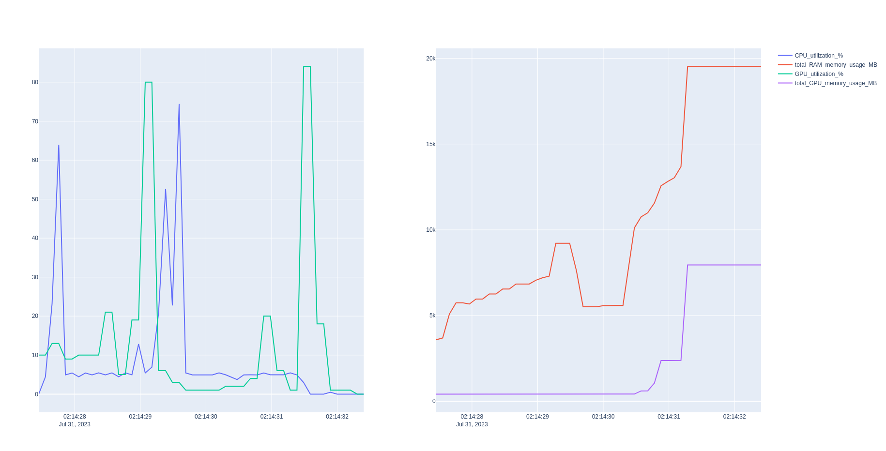

# pyprof

Track your CPU/RAM/GPU(CUDA) utilization with an easy-to-use context wrapper

## Platform support

- CPU and RAM profiling: Linux, macOS (including Apple Silicon), and Windows.
- GPU profiling: NVIDIA GPUs through NVML (`nvidia-ml-py3`).
- On machines without NVIDIA/NVML (for example many AMD or Apple Silicon setups),
  profiling still works for CPU/RAM and GPU metrics are automatically disabled.

## Install
```bash
~$ git clone https://github.com/yotamraz/pyprof.git

~$ cd pyprof

~$ pip install -r requirements.txt
```

## Use

```python
from pyprof.profiler import Profiler

with Profiler(output_file_path='./') as prof:
    funky_func()
```

## Results

#### stdout:

```stdout
########## CPU_utilization_% ##########
Peak: 74.425 %


########## total_RAM_memory_usage_MB ##########
Peak: 19519.48046875 MB


########## GPU_utilization_% ##########
Peak: 84.0 %


########## total_GPU_memory_usage_MB ##########
Peak: 7950.625 MB


########## total runtime ##########
0:00:04.035351
```

#### html:


